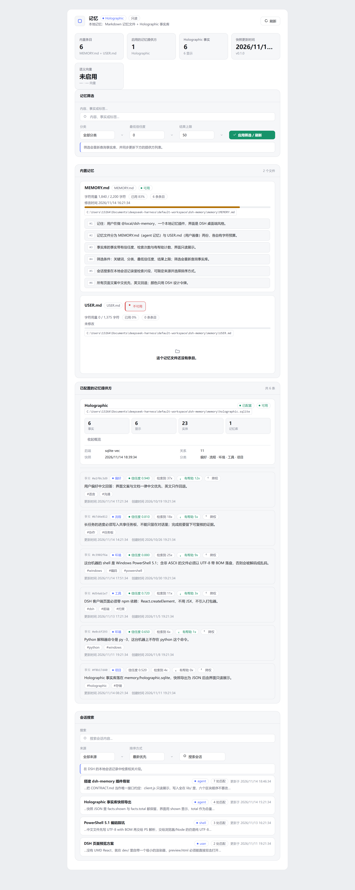

# dsh-memory

[](https://github.com/kiterli/dsh-memory/actions/workflows/tests.yml)
[](./LICENSE)
[](https://nodejs.org)
[](./package.json)

**为 DeepSeek Harness 打造的本地记忆插件** — Markdown 双层记忆 + Holographic 向量事实库。

全离线、零运行时依赖、中文语义检索。



---

## 它解决什么问题

普通 AI 对话每次都从零开始。你告诉它一次的事，下次还得再说一遍。

这个插件让 DSH 记住三样东西：

| 记住什么 | 例子 |
|---|---|
| **事实** | 你的硬件、常用路径、技术栈 |
| **偏好** | "回复用中文"、"不要分步问" |
| **经验** | "这个坑踩过，别再这么做" |

关键是它**不需要你特意说"记住"** —— 自动捕获模块会认出「以后都…」「我习惯…」「一律…」这类信号，自己存下来。

## 三层记忆模型

```
┌─────────────────────────────────────────────┐
│  Markdown 层    MEMORY.md / USER.md          │  ← 人可读、可手改
│                 字符预算 2200 / 1375          │
├─────────────────────────────────────────────┤
│  Holographic 层  1024 维 HRR 向量             │  ← 跨词边界语义匹配
│                 每条事实一个向量              │
├─────────────────────────────────────────────┤
│  检索层          关键词 / 向量 / HRR 三路      │  ← 精确命中硬优先
│                 时间衰减加权                  │
└─────────────────────────────────────────────┘
```

**为什么需要 HRR 层**：中文检索最大的坑是词边界。事实里写「显存」，你问「显卡内存」——子串匹配必然失败。HRR 用向量相似度跨过这个坑。

**为什么精确命中要硬优先**：早期版本用加权混合（关键词 1.0 / 向量 0.7 / HRR 0.3），结果高分的模糊匹配会挤掉字面精确命中。现在改成精确命中占固定槽位，永不被挤掉。

---

## 依赖说明（重要）

**核心功能零依赖。** 代码只用 Node 内置模块（`node:path` / `node:fs` / `node:worker_threads` / `node:crypto` / `node:sqlite` 等），`git clone` 后不装任何东西就能跑：

```bash
git clone https://github.com/kiterli/dsh-memory.git
cd dsh-memory
npm test          # 306 个测试，不需要 npm install
```

`package.json` 里有两个**可选**依赖，缺了只是能力降级，不会崩：

| 依赖 | 类型 | 缺了会怎样 |
|---|---|---|
| `@huggingface/transformers` | dependencies | 语义向量检索自动降级，退化为「关键词 + HRR 全息」两路召回。日志会打印一条 warn，功能不中断。 |
| `node-llama-cpp` | devDependencies | `npm run dl-model` 无法下载本地推演模型，反思/提炼能力不可用。 |

**要不要装？**

- 只想让记忆能用 → **什么都不用装**
- 想要最好的中文语义检索 → `npm install`（约 200MB，含 onnxruntime）
- 还想要本地模型做经验提炼 → `npm install --include=dev && npm run dl-model`

## 快速开始

### 1. 克隆到 DSH 插件目录

```bash
git clone https://github.com/kiterli/dsh-memory.git
cd dsh-memory
```

### 2. 挂进 DSH profile

```bash
node tools/install.mjs          # 干跑，只打印会改什么
node tools/install.mjs --apply  # 真正写入
```

### 3. 重启 DSH

左侧栏会出现「记忆」入口。

### 4. （可选）下载语义检索模型

需要先装开发依赖（模型约 1GB，从 hf-mirror 下载）：

```bash
npm install --include=dev
npm run dl-model
```

不装也能用 —— 会退化成关键词 + HRR 检索，只是少了向量语义这一路。

---

## 怎么用

**平时正常聊天就行。** 该记的东西它自己记。

需要主动干预时，模型有四个工具：

| 工具 | 用途 |
|---|---|
| `memory_record` | 存一条事实 |
| `memory_search` | 检索 |
| `memory_list` | 列出已有 |
| `memory_forget` | 删除 |

界面上可以：按分类筛选、调最低信任度、按时间排序、搜索本地会话记录。

---

## 技术特点

| 特点 | 说明 |
|---|---|
| **零运行时依赖** | 纯 Node ESM，SQLite 用内置 `node:sqlite` |
| **全离线** | 不联网、不调 API |
| **双后端** | SQLite 优先，不可用时自动退化为原子写 JSON |
| **可回滚** | 每次改动存版本，`fact_versions` 保留历史 |
| **可量化** | `tools/eval-recall.mjs` 测检索准不准 |
| **隐私** | 数据只在 `~/.dsh/memories/`，不进仓库 |

## 测试

```bash
npm test
```

306 个测试，覆盖存储、检索、衰减、自动捕获等全部模块。CI 在 Linux / Windows / macOS × Node 22 / 24 上跑。

---

## 文档

- [CONTRACT.md](./CONTRACT.md) — 接口契约
- [CONTRACT.v3.md](./CONTRACT.v3.md) — v3 设计与数据模型

## License

[MIT](./LICENSE)

---

# 以下为详细文档

为 DeepSeek Harness 桌面端打造的**本地、离线**记忆插件：像 Hermes 那样把长期记忆分成两层——

1. **Markdown 层**：`MEMORY.md`（Agent 记忆）与 `USER.md`（用户画像），条目以单独一行 `§` 分隔，各有字符预算（默认 agent **2200** / user **1375**，可配置）。
2. **Holographic 层**：一个真正的**向量符号记忆**（Holographic Reduced Representation，HRR），每条事实被投影成 1024 维向量。它让**中文检索跨过"词边界"的坑**：事实里写的是「显存」，你用「显卡内存」问也能命中——靠的是向量相似度而不是子串匹配。存储用本地 SQLite（无 SQLite 时自动退化为原子写的 JSON 文件）。

带一个贴合 DSH 桌面端设计语言的**「记忆」页面**（侧栏入口 + 主面板），展示统计卡、记忆筛选、内置记忆文件、已配置的记忆提供方（含每条事实的信任度 / 检索数 / 有帮助数）与本地会话搜索。

全部**离线、零 npm 依赖**（纯 Node ESM，SQLite 用 Node 内置 `node:sqlite`，自研 FNV-1a+HRR）。

---

## 1. 一键安装进 DSH

插件以 `link:` 方式挂在 DSH profile 下（模式与 `@local/dsh-craft-anything` 相同）。

```bash
node dsh-memory/tools/install.mjs                  # 干跑：打印将改动的 profile 路径
node dsh-memory/tools/install.mjs --verify         # 校验当前安装状态
node dsh-memory/tools/install.mjs --apply          # 写 profile + 跑 pnpm install --offline
node dsh-memory/tools/install.mjs --revert         # 还原到最后一次备份
```

`--apply` 会：
1. 备份 `profiles\desktop\package.json` 与 `pnpm-lock.yaml` 到 `.dsh-memory-backup-<时间戳>`；
2. 在 `dependencies` 写入 `"@local/dsh-memory": "link:C:/.../default-workspace/dsh-memory"`；
3. 把 `@local/dsh-memory` 追加到 `dsh.profile.bundles`；
4. 用 DSH 内置的自带 pnpm（`app.asar.unpacked\node_modules\pnpm`）跑 `install --offline`——因为是本地 link，不需要外网。

安装后**重启 DSH 桌面端**，在左侧栏出现「记忆」入口。`--verify` 会真实加载 host 半并断言 9 条路由都注册成功。

> `--apply` 写的是 workspace 之外的 profile 目录，需要一次授权（danger-full-access）。`--revert` 可随时回到安装前状态。

## 2. 手动验证（无需装进 DSH）

```bash
node --check dsh-memory/*.js dsh-memory/lib/*.js dsh-memory/tools/install.mjs

node dsh-memory/test/decay.test.mjs          # 15（记忆寿命：7天/1年可用、单调、半衰期、地板）
node dsh-memory/test/autocapture.test.mjs    # 15（主动捕获只收完整句、不记密钥/闲聊）
node dsh-memory/test/md.test.mjs             # 13
node dsh-memory/test/store.test.mjs          # 26（JSON vs SQLite 一致性 + 原子写）
node dsh-memory/test/hrr.test.mjs            # 15（确定性 / 中文检索 / 性能）
node dsh-memory/test/embed.test.mjs          # 10
node dsh-memory/test/routes.test.mjs         # 2（host 半端到端，含 selfcheck 全绿）
node dsh-memory/test/agent.test.mjs          # 3（工具注册 / 记录 / 召回注入 / 忘记）
node dsh-memory/test/client.contract.test.mjs# 12（页面契约 + 六区域 + 设计令牌）
node dsh-memory/test/style-injection.test.mjs# 2
node dsh-memory/dev/render-preview.mjs       # 生成 dev/preview-snapshot.html
node dsh-memory/dev/live-smoke.mjs           # 真实 HTTP 冒烟（写入→查询→排序→selfcheck）

# 检索质量评测（真问题找不找得到答案；这是唯一测「准不准」的）
node dsh-memory/tools/eval-recall.mjs                          # 自动从库里生成字面+拒答查询
node dsh-memory/tools/eval-recall.mjs --fixture test/fixtures/recall-paraphrase.json
```

评测怎么读：

| 查询类 | 含义 | 怎么看 |
|---|---|---|
| `literal` | 事实原文的连续片段 | **地板，不是成绩**。全对只说明关键词通道没坏 |
| `paraphrase` | 用户真实问法（手写） | **真正的测量**。评级只看这个 |
| `unanswerable` | 库里没有的东西 | 拒答率 ≤0.5 直接判 `over-eager` |

> 本机 2026-11-13 基线（12 条事实，keyword + embedding + HRR 三通道全开）：
> paraphrase recall@5 = **1.0**，MRR = **0.9**，拒答率 = **1.0**，评级 **good**。
>
> 调优轨迹（同一批 10 条手写查询），值得记下来，因为它说明了「看起来更好」和「真的更好」
> 的区别：
>
> | 阶段 | 召回 | MRR | 拒答 | 评级 |
> |---|---|---|---|---|
> | 只有 keyword | 0.0 | 0 | 1.0 | poor |
> | + HRR（无锚点） | 0.8 | 0.524 | 0.5 | over-eager |
> | + 任意 token 锚点 | 0.7 | 0.617 | 1.0 | fair |
> | 锚点放宽（**假象**） | 1.0 | 0.87 | 0 | over-eager |
> | + 强 token 锚点必需 | 0.9 | 0.77 | 1.0 | good |
> | + 有证据的语义通道 | **1.0** | **0.9** | **1.0** | **good** |
>
> 中间那次 1.0 是靠 `我平`/`时几` 这类噪声二元组通过锚点的，拒答率同时崩到 0——这就是为什么
> 指标必须一起看，单看召回会被骗。
>
> 两次关键测量（都是在这台机器的真实数据上量的，不是猜的）：
> 1. **HRR 分数不可单独作判据**：相关查询 top 0.0937–0.1867，无关查询 0.0445–0.1353，
>    区间几乎完全重叠。
> 2. **embedding 分数也不可单独作判据**：无关查询「我希望你怎么写代码注释」拿到
>    0.457–0.485，高于真正正确的同义命中 0.4259。
>
> 所以两个联想通道都要求**证据**：强字面锚点（拉丁词 ≥3 字符 / CJK 二元组含非功能字），
> 或语义通道专有的**同义词桥**（`语言↔中文` 这类显式表，且只采信分数最高的一个候选）。
>
> 第三条测量同样重要：**高频动词不算证据**。一个漏网的拒答探针「中世纪手抄本使用的铁胆
> 墨水配方」曾经靠共享 `使用` 命中「深度使用 DSH 插件开发」。`使用/需要/可以/通过` 这类
> 词在任何技术文本里都有，不指代主题，现已整词排除。
>
> 最终成绩（两个 fixture 一起看）：
>
> | fixture | 指标 | 结果 |
> |---|---|---|
> | paraphrase（10 条手写真问法） | recall@5 / MRR / 拒答 | **1.0 / 0.9 / 2-2** |
> | 自动字面（10 条原文片段） | recall@5 / MRR | **1.0 / 0.833** |
> | 自动拒答（6 条库外问题） | 拒答率 | **6/6** |

全套 **113 项**，全部通过。

> 自检接口 `GET /api/dsh-memory/selfcheck` 现在包含 `recall.decay`（半衰期与 7 天/1 年
> 可检索性）与 `recall.perTurn`（两个不同问题必须取到不同事实）两项回归探针。

> `node --test dsh-memory/test/` 在此机上会因沙箱 `spawn EPERM` 失败——请直接运行上面的单文件命令，`node:test` 仍在进程内执行并报通过/失败。
>
> `routes`/`agent` 测试自带 `DSH_MEMORY_NO_EMBED=1`：Node 22 下 Worker 的两个 MessagePort 在
> `terminate()` 后仍存活，会让测试进程无法退出。真实运行时（DSH 内）embedder 照常启动。

## 3. 数据存哪

| 项 | 路径 |
|---|---|
| 记忆根目录 | `<DSH_HOME>/memories`（`DSH_HOME` 缺省为 `~/.dsh`） |
| Agent 记忆 | `memories/MEMORY.md` |
| 用户画像 | `memories/USER.md` |
| 事实库 | `memories/memory_store.db`（无 `node:sqlite` 时为 `memory_store.json`） |

可用 `DSH_MEMORY_HOME` 环境变量或插件 `config.home` 覆盖。`MEMORY.md`/`USER.md` 用 `.lock` 做并发保护，写入走临时文件+改名（原子），且带防 EPERM 重试。

## 4. 记忆是怎么被「记住」和「调用」的（重要）

面板只是**只读展示**。真正让记忆工作的是一层 agent 接口（`lib/agent.js`），它由两部分组成：

### 写入：模型可调用的四个工具

| 工具 | 作用 |
|---|---|
| `memory_record` | 存一条持久事实（`content` / `category` / `tags` / `trust`） |
| `memory_search` | 关键词 + HRR 向量检索（中文换词也能命中） |
| `memory_list` | 列出记忆与分类计数 |
| `memory_forget` | 按 id 或最佳匹配删除 |

同时通过 `ctx.systemPrompt.section` 注入一段**指令**，明确告诉模型：

> **当用户说「记住…」「记一下…」「remember that…」「以后都…」**，或陈述持久偏好/决策/纠正/机器事实时，**立即调用 `memory_record`**。只在回复里说"好的我记住了"而不调用工具，这条记忆会在回合结束时丢失。

没有这段指令，模型不知道工具存在，也就不会调用 —— 这就是"只做了界面"会失败的原因。

### 调用：每步自动注入

`ctx.on('agent/pre-step', …, { prepend: true })` 在每一轮把两层记忆拼进模型输入：

1. **Markdown 档案** — `USER.md`（关于用户的画像）+ `MEMORY.md`（长期笔记）的全部条目；
2. **相关事实** — 用用户这句话做一次检索，取信任度 ≥ 0.5 的前 4 条。

注入的消息带明确前缀 `[dsh-memory context — injected automatically, not a message from the user]`，避免模型误以为是用户说的话。

检索走 `retrieveFacts()`：**关键词命中优先**，不足时用 HRR 向量在全库排序补齐 —— 搜索工具和自动召回共用同一个函数，所以模型看到的和面板看到的排序一致。

### 一句话区分

| 现象 | 说明 |
|---|---|
| 面板显示 `0` 条 | 没人写过。模型需要调用 `memory_record`（说「记住」就会触发） |
| 说了「记住」却没存 | 重启 DSH 后重试；若仍无效，看 `/api/dsh-memory/selfcheck` 的 `agent.tools` 项 |
| 模型不主动想起 | 检查 `agent.recall` 是否为 `true`，以及 `USER.md` 是否有内容 |

`GET /api/dsh-memory/selfcheck` 现在包含 `agent.tools` 与 `agent.recall` 两项 —— 它们是"记忆是否真的被使用"的判定依据，缺一即为空壳。


## 5. `GET /api/dsh-memory/selfcheck`

部署后最值钱的探针——对**正在运行的 DSH 里的本插件**做端到端自检：

- `config.home`/`config.version`/`markdown.layer`/`store.layer`/`store.stats`/`markdown.read`
- 真实 round-trip：写一条探针事实 → 查询命中 → 删除 → 确认删干净（`store.roundtrip`/`store.cleanup`）
- Holographic 层健康：编码确定性 + 向量是单位向量（`holographic.encode`）；「显卡显存怎么分配？」确实让 GPU 事实排在无关事实前（`holographic.rank`）
- 会话扫描（`sessions.scan`）

浏览器打开 `http://127.0.0.1:<port>/api/dsh-memory/selfcheck` 即可，回报 `{ok, passed, total, checks[]}`。

## 6. 设计决策（刻意，非疏漏）

- **没抄 Hermes 的绿色强调色 `#196d31`**：用户要求"符合 dsh 桌面端的 ui"，所以整页只用 DSH 的 `--dsw-alias-*` 设计令牌（主按钮用 `--dsw-alias-brand-primary`，预算条用 `state-success/warn/error`）。见 `client.js` 顶部注释。
- **HRR 是真实的**（不只是关键词索引的壳）：`bind`=循环卷积、`bundle`=归一化求和、`similarity`=余弦；`encode` 用**去重 token 的 presence 加权**（不是词频，否则重复虚词会支配短查询）。时间戳格式/百分比/信任度 3 位小数等都与 Hermes 面板一致。
- **排序规则**：关键词命中的事实永远排在纯向量命中的之前（字面匹配是精确证据，向量匹配是猜测）；组内按 HRR 分数降序。
- **下限信任度选项**用了 Hermes 的实测值 `0 / 0.3 / 0.5 / 0.75`。

## 7. 限制 / 未完成的

- 页面设计令牌清单取自 DSH 现网可用项；若未来 DSH 新增令牌，只需在 `client.js` 引用处替换。
- 会话搜索读取 DSH 的 `sessions/*/session.v4.jsonl.zstd`（zstd JSONL）；运行时若无 `zlib.zstdDecompressSync`（Node<23.8）会友好降级并注明。
- 事实库尚无 `fact_versions` 双时态历史（Hermes 有）；当前是"每事实一行 + 计数"的简化，够支撑本页面。
- JSON 后端不是通用 SQL 引擎：维护类操作（归档 / 清理 / 矛盾 / 反馈 / 事件 / 边）按固定语句在 `JsonBackend.run/all` 里各实现一份，新增维护 SQL 时必须同步补 JSON 分支，否则会显式抛错。
- 自动捕获（`lib/autocapture.js`）是规则式的，宁可漏也不误记；真正的"每周把零散事实压缩成结论"的巩固环节尚未实现。

## 8. 关于"记忆会不会过期"

不会。三层衰减只影响**排序**：`lib/decay.js` 把 body(3.5d)/summary(4.8d)/keyword(7.1d) 三层
按 0.5/0.3/0.2 加权混合，再把结果压到 `[0.35, 1]` 下限，因此一年前的记忆仍有 35% 权重、
仍可被 `memory_search` 与自动召回取到。真正移除记忆只有两条路：

1. `archiveOldFacts`（旧 + 从未被召回 + trust ≤ 0.5 + ≥180 天）——**归档不删除**，行仍在库与导出里；
2. `memory_forget` / `cleanupStaleFacts` 的显式删除。

> 历史教训：v3.1 之前的公式把三层因子**连乘**（等效半衰期 1.58 天）并配 0.2 硬阈值，
> 导致第 4 天起所有记忆对模型不可见。现在的 `/selfcheck` 有 `recall.decay` 与
> `recall.perTurn` 两项探针专门防止这类退化再次发生。